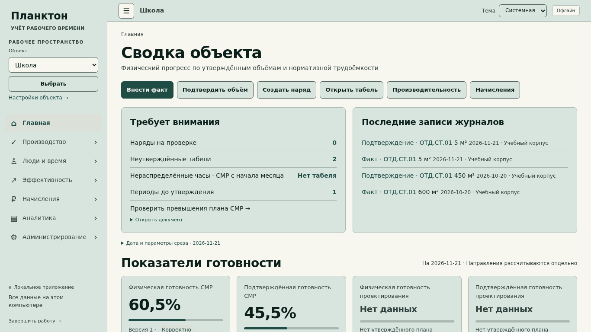
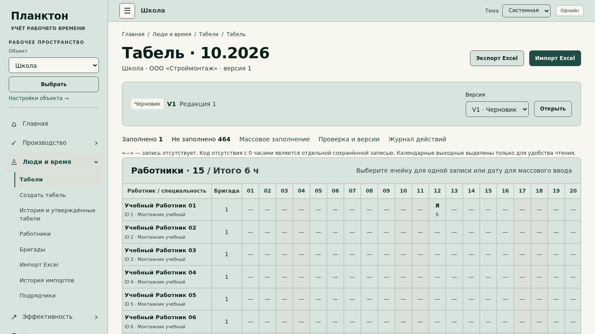

# ПЛАНКТОН. Учёт рабочего времени 2.0 — руководство пользователя

Пройдите учебную смену от настройки объекта до расчёта начислений. Затем возвращайтесь к нужному разделу по оглавлению. Названия в кавычках соответствуют меню, кнопкам и блокам версии 2.0.

## Оглавление

1. [Установка и первый запуск на Mac](#1-установка-и-первый-запуск-на-mac)
2. [Главная, объекты и корпуса](#2-главная-объекты-и-корпуса)
3. [Кодификатор и ведомости объёмов](#3-кодификатор-и-ведомости-объёмов)
4. [Подрядчики, работники, бригады и импорт](#4-подрядчики-работники-бригады-и-импорт)
5. [Факт, подтверждение и исправления](#5-факт-подтверждение-и-исправления)
6. [Наряд от черновика до закрытия](#6-наряд-от-черновика-до-закрытия)
7. [Табель и утверждение часов](#7-табель-и-утверждение-часов)
8. [Распределение часов и производительность](#8-распределение-часов-и-производительность)
9. [Управленческие начисления](#9-управленческие-начисления)
10. [Аналитика, история и Excel](#10-аналитика-история-и-excel)
11. [Проверка учебной смены](#11-проверка-учебной-смены)
12. [Диагностика, резервирование и восстановление](#12-диагностика-резервирование-и-восстановление)

## 1. Установка и первый запуск на Mac

1. Установите [CPython 3.13.12 universal2](https://www.python.org/downloads/release/python-31312/).
2. Загрузите исходники из GitHub через **Code → Download ZIP** и распакуйте архив. В Terminal введите `cd `, перетащите распакованную папку в окно и нажмите Enter. Если загружали ZIP, выполните `chmod +x start.command`.
3. Запустите подготовку и откройте отдельную базу приёмки.

   ```bash
   ./start.command --prepare --test-db
   ```

   Подготовка устанавливает библиотеки в `.venv` и требует интернета. После запуска браузер открывает локальную страницу. Если вкладка не открылась, скопируйте адрес `http://127.0.0.1:…` из Terminal. Приёмочная база находится в `data/acceptance/acceptance.sqlite3`.

4. Для повторного открытия учебной базы используйте `./start.command --test-db`. Для рабочего запуска используйте `./start.command`. Рабочие данные сохраняются в `data/construction_progress.sqlite3`. Закрывайте сервер кнопкой «Завершить работу» в меню или через Ctrl+C в Terminal.

Для примеров ниже выберите текущий день по UTC. Используйте этот день для факта, подтверждения и записи часов. Табель и расчётный период создавайте на тот же месяц. План должен быть утверждён до регистрации объёма. Все имена и суммы в примере учебные. [Подробная инструкция macOS](macos_first_run.md)

## 2. Главная, объекты и корпуса

На главной видны текущий объект, готовность по СМР и проектированию, очередь внимания и последние записи. Используйте быстрые входы «Внести факт», «Подтвердить объём», «Создать наряд», «Открыть табель», «Производительность» и «Начисления». Тема переключается в шапке.

1. Откройте **Администрирование → Строительные объекты**. Создайте «Учебная школа» с уникальным кодом `DEMO-SCHOOL`. Укажите один корпус «Учебный» с кодом `К1` и нажмите «Создать объект и корпуса».
2. Новый объект сразу станет текущим. Зайдите в **Администрирование → Корпуса и конструктивы** и добавьте этаж `1` в «Учебном».
3. В карточке объекта можно исправить его название и код, добавить или переименовать корпус, изменить порядок, отправить объект или корпус в архив и восстановить его. Этажи редактируются в разделе корпусов. Удаление корпуса проходит через просмотр зависимостей и отдельное подтверждение. Для корпуса с учётными данными используйте архив.
4. Чтобы сменить объект, выберите его в боковом меню и нажмите «Выбрать». Перед сохранением проверьте имя объекта в шапке. Если старая вкладка открыта после смены объекта, обновите страницу и проверьте контекст формы.



Срез на главной меняется в блоке «Дата и параметры среза». Текущие задачи скрываются в историческом режиме. «На сегодня» возвращает оперативную сводку. [Подробнее об объектах](workspaces.md) · [Удаление и архив корпусов](building_management.md)

## 3. Кодификатор и ведомости объёмов

**Код работы** задаёт название, конструктив и единицу измерения. **Учётная позиция** связывает работу с корпусом, этажом и направлением. Один код может использоваться в нескольких местах. Кодификатор общий для объектов.

1. Откройте **Администрирование → Кодификатор видов работ**. Найдите работу в квадратных метрах или создайте код `DEMO-WALL` для учебной отделки стен. В карточке кода можно изменить описание и сохранить справочную норму. Справочная норма может подставляться в новую строку ведомости. Норма утверждённой версии хранится в самой строке плана.
2. Откройте **Производство → Ведомости объёмов**. Выберите направление **СМР**. В «Добавить учётную позицию» укажите корпус «Учебный», этаж `1` и работу.
3. В «Новый черновик плана» выберите «Пустой план» и нажмите «Создать черновик». В строке позиции введите план **100 м²** и норму **0,8 чел.-ч/м²**, затем нажмите «Сохранить». Трудоёмкость плана составит **80 чел.-ч**.
4. Проверьте строки и нажмите «Утвердить версию». Утверждённая работа появляется в журнале выполнения. СМР и проектирование ведутся отдельными версиями.

Для пересмотра плана создайте черновик на основе утверждённой версии. Сохраните изменения по строкам, исключите из черновика лишние позиции, проверьте предупреждения и утвердите новую версию. Прежнюю можно открыть фильтром версии. События по исключённым позициям остаются в истории. [Ведомость и движение объёмов](event_flow.md)

## 4. Подрядчики, работники, бригады и импорт

1. В **Люди и время → Подрядчики** заведите «Учебный подрядчик». Сделайте его доступным на нужном объекте. Операция «Открыть на объекте» добавляет доступность существующей организации.
2. В **Администрирование → Специальности** заведите специальность «Отделочник». В **Люди и время → Работники** создайте, например, «Работник Учебный» и выберите подрядчика и специальность. При необходимости заведите отдельного ответственного для нарядов. Одинаковые ФИО могут принадлежать разным людям. При выборе и импорте проверяйте ID и подрядчика.
3. В **Люди и время → Бригады** создайте бригаду `Б-01` у этого подрядчика. В карточке бригады назначьте работника с датой, действующей на день учебной смены. Там же можно перевести или исключить человека, посмотреть состав на выбранную дату и историю. Эти действия доступны и из карточки работника через назначение и доступность. Архивирование карточки сохраняет ранее оформленные документы.

Для массового ввода откройте **Люди и время → Импорт Excel**.

1. Скачайте [шаблон персонала](templates/Construction_Progress_4_1_Шаблон_импорта_работников.xlsx) или возьмите актуальный шаблон в мастере. Заполняйте лист «Работники».
2. Выберите объект, подрядчика и дату начала назначений. Загрузите `.xlsx` и просмотрите ошибки и совпадения.
3. Для неоднозначных строк выберите «Создать», «Связать», «Обновить» или «Пропустить». При связывании и обновлении проверьте ID. При завершении назначения используйте явный флажок.
4. Откройте предварительный просмотр, проверьте строки и создание новых специальностей или бригад, затем подтвердите импорт. До подтверждения можно отменить мастер или вернуться к нему через **История импортов**.
5. Проверьте карточки, доступность и состав. Ошибку после применения исправляйте в карточках либо новым импортом с явными решениями. Пропущенные в файле работники остаются в справочнике.

[Поля шаблона, совпадения и ограничения Excel](stage41_personnel_import.md)

## 5. Факт, подтверждение и исправления

1. На главной нажмите **«Внести факт»**. Найдите учётную позицию по коду, названию или расположению. Проверьте корпус, этаж, единицу и остаток. Введите **60 м²** как объём отдельного события и сохраните выполнение. Наряд указывайте только для работы, которая действительно сделана по нему.
2. Нажмите **«Подтвердить объём»**. Выберите ту же позицию во вкладке ожидающих подтверждения. Введите **45 м²**, дату и документ-основание «Учебный акт № 1». Сохраните. В очереди останется **15 м²** к подтверждению, в ведомости — **40 м²** до планового объёма.
3. Найдите обе записи в историях соответствующих журналов. Для исправления откройте действие корректировки у исходной записи либо общий переход к корректировкам истории. Укажите изменение со знаком, дату и причину. Для исправления подтверждения заполните документ-основание. Например, чтобы уменьшить подтверждение с 45 до 40, добавьте **−5** со ссылкой на исходное подтверждение. Исходная запись останется видна. Для итогов учебного примера оставьте 45 либо восстановите объём отдельным обоснованным изменением.
4. Раскройте «Фильтры и дата среза», чтобы посмотреть другой корпус, этаж, версию или прошлую дату. Чтобы снова ввести данные, вернитесь к текущему срезу.

Подтверждение ограничено фактом, доступным на его дату. Факт выше плана виден как отклонение. Превышение задания по строке наряда требует отдельного согласия и причины. [Даты, проверки и связь журналов](event_flow.md)

## 6. Наряд от черновика до закрытия

Для упражнения с нарядом заведите вторую позицию с планом, например на другом этаже. Это позволит сохранить контрольные цифры первой работы.

1. На главной нажмите **«Создать наряд»**. Выберите работу из утверждённой ведомости, проверьте расположение и единицу, укажите объём на смену. При необходимости добавьте строки. Укажите дату и время смены, подрядчика, ответственных и состав исполнителей. Можно подобрать постоянную бригаду на дату и проверить заполненный состав.
2. Сохраните черновик. Откройте его, проверьте работы и исполнителей и нажмите «Выдать наряд». Выдача присваивает номер и сохраняет реквизиты и состав. Карточка содержит печатную форму и историю статусов.
3. В блоке «Выполнение и подтверждение» запишите факт по строке. Затем отдельно зарегистрируйте подтверждение с документом-основанием. Для простого закрытия задания на **10 м²** запишите факт и подтверждение по **10 м²**. Проверяйте, что выбран нужный номер и строка.
4. Нажмите «Сдать на проверку», укажите ответственного. Через «Проверить наряд» отметьте каждую строку, добавьте замечания и подтвердите проверку. Затем выполните «Закрыть наряд», когда у каждой строки есть решение по всему объёму.

**Частичное исполнение.** В карточке проверьте остаток, связанный факт, подтверждение и уже принятые решения. Допустимый невыполненный объём можно перенести в новый черновик с проверкой основания, количества и исполнителя. После просмотра выдайте дочерний наряд, чтобы перенос вошёл в баланс исполнения. Доступный черновой перенос можно отменить. Если работы отменены, оформите списание остатка с причиной. Ошибочное списание исправляется через «Отменить списание» в истории решений. При изменении объёмов или переноса повторите проверку перед закрытием.

**Объём уже зарегистрирован без наряда.** Откройте сопоставление у подходящей строки, проверьте позицию, исходное событие, доступное количество и основание. Сохраните решение. Для исправления запишите новую редакцию сопоставления. Журналы факта и подтверждения сохраняют свои исходные события.

**Поиск и контроль.** В **Производство → Наряды-задания** используйте номер, смену, подрядчика, корпус, бригаду и статус. В **Контроль нарядов** ищите незакрытые задания, остатки, переносы и расхождения, открывайте цепочку и историю, скачивайте Excel. Отмена самого наряда выполняется отдельно с причиной и доступна по состоянию документа. [Жизненный цикл, переносы и основания закрытия](stage45_work_orders.md)

## 7. Табель и утверждение часов

1. В **Люди и время → Табели** выберите подрядчика и нажмите «Создать табель». Укажите месяц учебной смены. Табель создаётся для текущего объекта, подрядчика и месяца. Если запись за этот месяц уже существует, откройте её из реестра.
2. В черновике разверните «Добавить работников в состав табеля», выберите работника и нажмите «Добавить выбранных без явок и часов». Для учебной смены нажмите на ячейку работника в нужный день и сохраните **Я, 8 часов**.
3. Для нескольких работников или дней используйте «Массовое заполнение». Нажатие на заголовок дня в сетке открывает форму с этой датой. Выберите период, бригаду или состав, код и часы, нажмите «Проверить изменения». В предварительном просмотре проверьте замены и подтвердите применение. В «Копировать заполнение между датами» выберите день-источник и дни назначения, затем проверьте предварительный просмотр.
4. Для исправления черновика смените код или часы в ячейке. «Очистить запись» возвращает ячейку в незаполненное состояние. К табелю и к строке работника можно добавить примечания. В журнале доступны записи до и после изменения.
5. В «Проверка и версии» выполните **«Передать на проверку»**, затем **«Утвердить табель»**. Пока табель на проверке, его можно вернуть в черновик с причиной. Неутверждённую версию можно отменить с основанием. Для исправления утверждённого табеля создайте корректирующую версию, внесите изменения и снова пройдите передачу и утверждение. Старые версии доступны в «История и утверждённые табели» и через выбор версии в карточке.

Пустая ячейка означает отсутствие записи. Явка, выходной, отпуск, больничный и неявка имеют собственные коды. Для явки указываются часы, для нерабочих кодов используйте правила поля. Предел — 24 часа на человека за дату суммарно по объектам. В начисления и распределение попадают утверждённые часы.

**Excel.** Из карточки скачайте шаблон или экспорт. Для загрузки используйте лист «Табель» с колонками ID работника, ФИО, дата, код, часы. Работник по ID должен входить в состав версии. Откройте импорт в черновике, загрузите файл, проверьте ошибки и подтвердите изменения по результатам просмотра. Экспорт включает месячную матрицу, плоский лист для импорта и сведения о версии. [Шаблон и правила табеля](stage42_timesheets.md)



## 8. Распределение часов и производительность

**Распределение часов.** Откройте **Эффективность → Распределение часов**. Выберите период, дату, подрядчика и при необходимости бригаду. Выберите работника с утверждённой явкой и работу из ведомости. Назначьте **8 часов** учебной смены на работу с фактом 60 м². При нескольких источниках часов проверьте работника, работодателя и дату. Для массовой операции выберите бригаду и работу, отметьте работников и укажите часы каждого. Проверьте предварительный просмотр и примените. В таблице исправлений задавайте новое значение. Ноль для существующего назначения снимает распределение. Если исходный табель скорректирован, проверьте конфликты и обновите назначения.

**Исполнители объёмов.** Откройте **Эффективность → Исполнители объёмов**. Выберите положительную исходную запись факта, укажите её долю, подрядчика и при необходимости бригаду и работника. Для учебного примера назначьте **60 м²** тому же исполнителю. Сумма назначенных долей ограничена объёмом источника с учётом исправлений. Чтобы сменить исполнителя, снимите или уменьшите старое назначение и добавьте новое. Атрибуция факта сохраняет исходные данные журнала. Сдельное сопоставление делается отдельно по подтверждению.

**Чтение отчёта.** Откройте **Эффективность → Сводка производительности**, затем вкладки «Выработка по работам», «Подрядчики» и «Бригады». Выберите период, направление и режим фактического либо подтверждённого объёма. Раскройте расширенные фильтры для расположения, кода, версии и отсечения знаний. Сверьте:

| Показатель | Как читать |
|---|---|
| Нормативные трудозатраты | Трудоёмкость объёма по норме утверждённого плана |
| Фактические часы | Рабочие часы утверждённого табеля |
| Распределённые и нераспределённые часы | Сколько часов отнесено к работам и сколько осталось |
| Фактический и подтверждённый объём | Данные двух самостоятельных журналов |
| Выработка и отношение к норме | Результат по работе или исполнителю при достаточном объёме и часах. При неполных исходных данных изучите предупреждение |

Используйте «История операций» для ревизий и «Скачать Excel» для выбранного периода и фильтров. [Источники, формулы и конфликты](stage43_labor_productivity.md)

## 9. Управленческие начисления

Начисления служат для внутреннего учёта. Изучайте источники и предупреждения до утверждения ведомости.

### Почасовая, окладная и комбинированная оплата

1. Откройте **Начисления → Условия оплаты**. Выберите работника и подрядчика, способ оплаты, даты и сумму ставки или оклада. Для упражнения задайте почасовую ставку **500 ₽/ч** с начала учебного месяца. Начальная дата входит в интервал, конечная исключается. При смене ставки задайте последовательные интервалы. История содержит прежние редакции условий.
2. В **Начисления → Расчётные периоды** создайте период по подрядчику и месяцу. Введите норму **160 часов** для упражнения. Для реального окладного расчёта укажите фактическую норму полного месяца. Комбинированные условия позволяют выбрать базу и отдельно задать сдельный компонент, премию и доплату.
3. Откройте период. Проверьте исходные данные, затем нажмите «Рассчитать начисления». Для 8 утверждённых часов по 500 ₽/ч без других составляющих ожидается **4 000 ₽**. Откройте расчётную строку и проверьте её источник. Если меняете исходные параметры, пересчитайте ведомость перед передачей.

### Сдельная работа, операции, премии и корректировки

1. В **Начисления → Расценки** задайте код, единицу, сумму, даты действия и область применения. При необходимости сначала заведите операцию в «Технологические операции» и задайте расценку именно для неё. Условия работника должны допускать сдельную часть.
2. В **Сопоставление подтверждений** выберите исходное подтверждение, количество, исполнителя и документальное основание. При оплате отдельной операции укажите её явно. Один и тот же источник нельзя оплачивать повторно за весь объём работы и как составляющую операцию.
3. В карточке периода откройте «Сдельное распределение». Выберите сопоставление, оплачиваемую часть и получателей. Доступны равные доли, распределение по часам этой работы, КТУ и ввод сумм вручную. Проверьте предпросмотр объёмов, долей и сумм, затем подтвердите. Для исправления открытой версии отмените ошибочную партию с основанием, проверьте резерв и выполните новое распределение.
4. В условиях оплаты доступны предусмотренные правила премий. В карточке периода можно добавить ручную премию, доплату или корректировку с датой, суммой и основанием. Проверьте отражение в строках расчёта и пересчитайте ведомость.

### Проверка, утверждение и история

После расчёта проверьте суммы, строки источников, отклонения от предыдущей версии и ошибки. «Передать на проверку» открывает утверждение. При ошибках используйте «Вернуть на доработку» с причиной, исправьте источники и пересчитайте. После утверждения при необходимости закройте период. Для исправления сохранённой ведомости создайте корректирующую версию с причиной, пройдите расчёт и проверку заново. Старый результат доступен через выбор версии. В «Сводке начислений» отфильтруйте нужный месяц и подрядчика. Скачайте Excel из карточки выбранной версии. [Оплата, сдельный резерв, премии и снимки](stage44_payroll.md)

## 10. Аналитика, история и Excel

1. Откройте **Аналитика → Физическая готовность**. Выберите направление, корпус, этаж или код, версию плана и дату отчёта. Физическая готовность учитывает нормативные веса плановых работ. СМР и проектирование читаются отдельно. Перейдите к истории прогресса из блока проверки исходных данных на главной для сравнения срезов.
2. В **Натуральные объёмы** сравните план, факт, подтверждение и остатки в единицах работ. В **Отклонения** выберите неподтверждённый факт, превышение плана или отсутствие выполнения и откройте нужную позицию. Проверьте предупреждения об исходных данных.
3. В **Аналитические группы** создайте именованную выборку с автоматическим правилом и ручными включениями и исключениями. Сохраните редакцию. Можно открыть прежнюю редакцию, архивировать, восстановить или вернуться к автоматическому составу. При разных единицах анализируйте объёмы отдельно. Калькулятор нормативной выработки в «Натуральных объёмах» использует код работы, численность, часы смены и норму. Например, один человек за 8 часов при 0,8 чел.-ч/м² даёт нормативные 10 м² за смену.
4. В **Динамика выполнения** выберите диапазон и шаг. Накопление показывает достигнутое к концу интервала, изменение — прирост за интервал. Для сравнения используйте одну версию плана и одну редакцию состава.
5. В **Экспорт отчётов** проверьте фильтры и скачайте XLSX. В книге есть сводка, объёмы, динамика, отклонения, группы и исходные данные. Для нарядов, табелей, труда и начислений используйте их собственные выгрузки.

Дата отчёта отвечает за события до выбранного дня. «Отсечение знаний» отвечает за время, к которому событие было зарегистрировано. Для воспроизведения отчёта сохраните обе даты, план, редакцию группы и фильтры. Для ручного отсечения подходит ISO-время с часовым поясом, например `2026-11-23T18:00:00Z`. [Отчёты, группы и состав XLSX](analytics.md)

## 11. Проверка учебной смены

Проверяйте ту же позицию, подрядчика и месяц. Если добавили отдельный наряд, выберите первую работу по коду или расположению. Для готовности **60% / 45%** используйте срез, где первая работа — единственная плановая позиция, либо смотрите её строку.

| Что открыть | Ожидаемый результат |
|---|---|
| Ведомость, первая работа | План 100 м², трудоёмкость плана 80 чел.-ч, факт 60 м², подтверждение 45 м² |
| Очередь подтверждения | Доступно ещё 15 м² |
| Утверждённый табель | 8 часов явки у учебного работника |
| Производительность | 8 утверждённых часов отнесены к первой работе, факт 60 м² назначен исполнителю |
| Почасовой период | 4 000 ₽ при ставке 500 ₽/ч и отсутствии других начислений |
| Наряд на вторую работу | Выдан, проверен и закрыт отдельными действиями. В истории по строке есть факт и подтверждение |

## 12. Диагностика, резервирование и восстановление

| Ситуация | Что проверить |
|---|---|
| Работа отсутствует в журнале | Текущий объект, направление, корпус, этаж, фильтры и утверждённую версию. Для старой версии откройте нужный срез. |
| Подтверждение отклонено | Дату, остаток и документ. Для наряда дополнительно проверьте строку и состояние документа. |
| Наряд не закрывается | Нерешённый остаток, выдачу дочернего переноса, состояние связанных решений, замечания и актуальность построчной проверки. |
| Часы пропали из отчёта | Месяц, подрядчика, объект и версию табеля. Нужна утверждённая версия, известная на дату отчёта. При корректировке проверьте распределения. |
| Начисления не утверждаются | Доступность утверждённых источников, интервалы оплаты, норму для оклада, совместимость расценок и остатки сдельных сопоставлений. После исправления пересчитайте. |
| Страница устарела после смены объекта | Обновите вкладку, проверьте объект и повторите операцию в его контексте. |
| Локальный сервер или окружение не запускаются | Откройте **Администрирование → Настройки приложения** для сведений о текущем запуске, если сервер работает. Для проверки с Terminal используйте `./start.command --check` или `./start.command --check --test-db`. |

Перед обновлением остановите локальное приложение и сделайте копию рабочего файла SQLite. Для восстановления сначала откройте копию под отдельным путём через `./start.command --db "/путь/к/копии.sqlite3"`. Сверьте миграции, объекты и отчёты. Затем действуйте по инструкции восстановления вашей установки. Сохраняйте оригинальный каталог данных, старую резервную копию и совместимую версию приложения. [Диагностика Mac](macos_first_run.md) · [Резервирование и возврат версии](workspaces.md)

Для Windows порядок запуска, размещение базы и резервные команды описаны в руководстве Portable. Для закрытого облачного стенда используйте отдельную инструкцию развёртывания и восстановления. Учётных записей и ролей в версии 2.0 пока нет. Утверждение в интерфейсе фиксирует внутреннее действие локального оператора. [Windows Portable](windows_portable.md) · [Закрытый стенд](v2_yandex_cloud_deployment.md)
